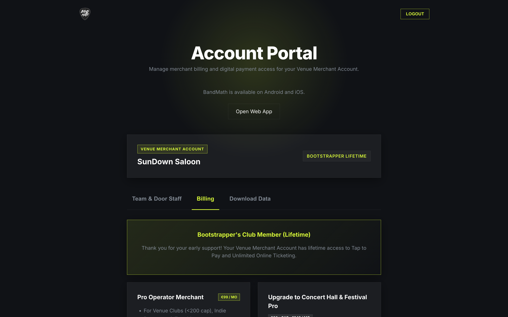
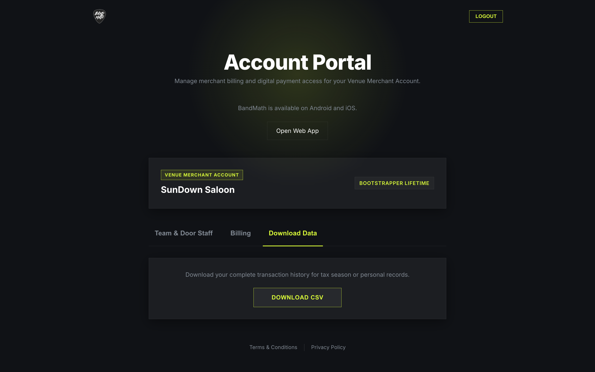

# Upgrading and Downgrading

BandMath offers flexible plans built for working musicians, independent venues, and tour managers. For garage bands and local acts, the core financial ledger, band calendar, setlist organizer, and show creation tools are 100% free. When you are ready to process live card payments—whether via **Tap to Pay**, **Stripe QR Codes**, or **Online Event Ticketing**—you can upgrade in seconds via our Web Accounts Portal.

## The Web Accounts Portal (`account.itsbandmath.com`)

To keep subscription costs low for independent artists and venues and avoid 30% App Store surcharges, all billing activities are managed through our dedicated Web Accounts Portal at **[account.itsbandmath.com](https://account.itsbandmath.com)**.

### Logging In with 6-Digit Email OTP
You can sign in to **[account.itsbandmath.com](https://account.itsbandmath.com)** from any desktop or mobile browser using:
* **6-Digit Email One-Time Code (OTP):** Enter your email address and input the 6-digit verification code sent to your inbox.
* **Google or Apple Sign-In:** One-click OAuth authentication.

## Subscription Tiers

All Core Ledger and Event Planning features in BandMath are 100% free. Upgrading unlocks live merchant payment processing and advanced commercial tools:

* **Free Tier (Core Ledger & Events):** Unlimited expense/income tracking, Automated Debt Settlement, Band Calendar, Setlist Organizer, creating or joining multi-band shows via Show Code, and participating in nightly Closing Room settlements.
* **Pro Merchant Plan (`€20/mo`):** Unlocks the commercial **Merch Stand** Point-of-Sale (POS), **Tap to Pay** on iPhone & Android, **Stripe QR Codes**, **Online Event Ticketing**, the **Sales Analyzer**, and the **Inventory Analyzer**.
* **The Bootstrapper's Club (`€100` One-Time Lifetime Pass):** Strictly capped at **100 public founding spots**, the Bootstrapper's Club unlocks lifetime Pro access for a single one-time payment with zero recurring monthly fees.

## Band Workspaces vs. Venue & Tour Manager Portals

The Web Accounts Portal automatically adapts to your active account persona:
* **For Bands:** Select which of your administrated bands you want to upgrade from the band selector, then open the **Billing** tab. Remember: **only one subscription is required per band workspace**, unlocking Pro features for every member of that band!
* **For Venues & Tour Managers (Billing-Only Merchant Portal):** When logged in as a **Venue** or **Tour Manager**, `account.itsbandmath.com` presents a focused **Billing-Only View** tied directly to your external Merchant Account. You can also jump straight to this portal from the **`MERCHANT & STRIPE PAYOUTS`** card inside **User Settings** in the mobile app.

## How to Upgrade

1. Navigate to **[account.itsbandmath.com](https://account.itsbandmath.com)** and log in via **6-Digit Email OTP** or OAuth.
2. For Band accounts, select your band from the dashboard and open the **Billing** tab (Venues and Tour Managers land directly on their Billing view).
3. Choose **Pro (`€20/mo`)** or **Bootstrapper's Club (`€100` Lifetime)** and click **Subscribe** / **Get Lifetime**.
4. Complete checkout through our secure Stripe Checkout page.

:::warning
For Band accounts, only **Admins** have permission to manage the band's subscription tier. If you are a standard Member and need to upgrade, ask a band Admin to log in at `account.itsbandmath.com`.
:::

## Downgrading or Pausing Between Tours

If your tour is over and you want to pause your monthly subscription until your next run of shows, you can downgrade at any time:

1. Go to **[account.itsbandmath.com](https://account.itsbandmath.com)** and open the **Billing** tab.
2. Click **Customer Portal** under "Manage Billing".
3. Cancel or pause your subscription inside the secure Stripe Customer Portal.

Your Pro features remain active until the end of your current billing cycle. All of your historical merch sales, event settlements, and ledger data are 100% preserved so you can pick right back up whenever you hit the road again.
