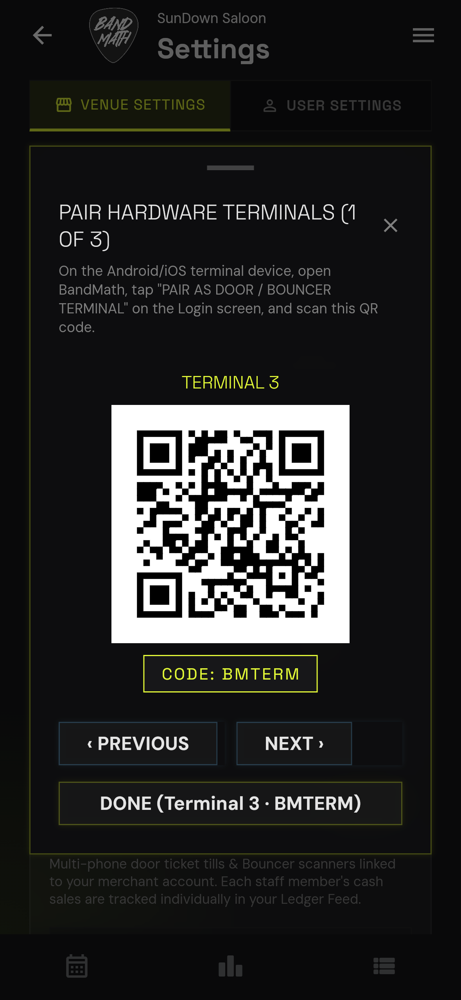
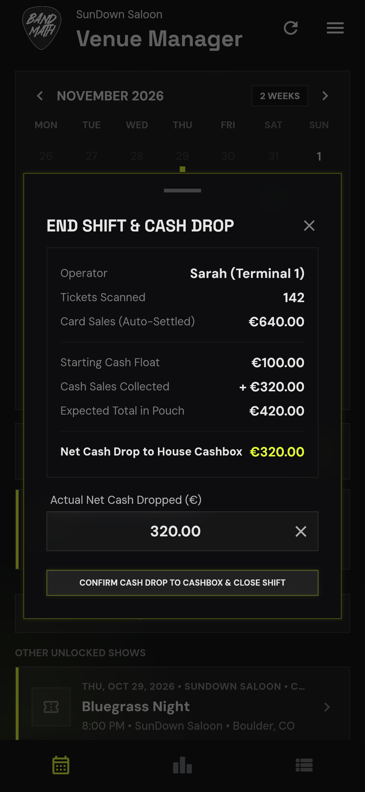
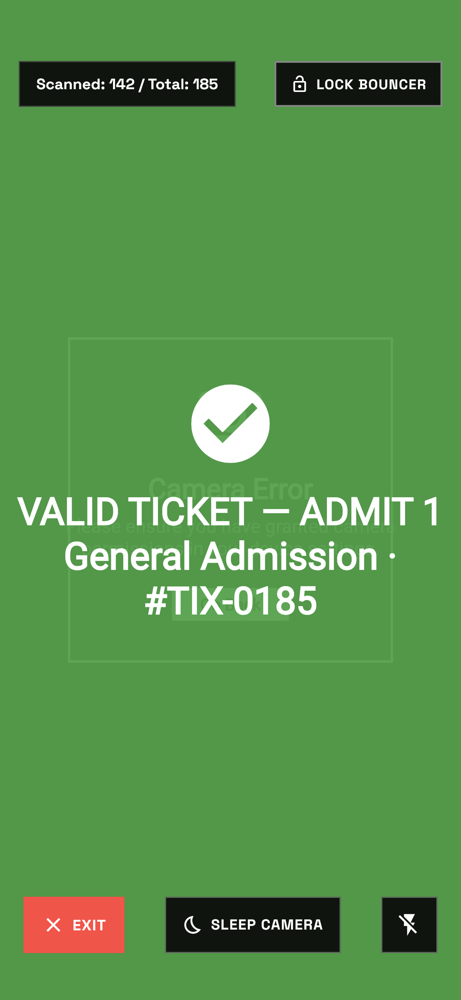
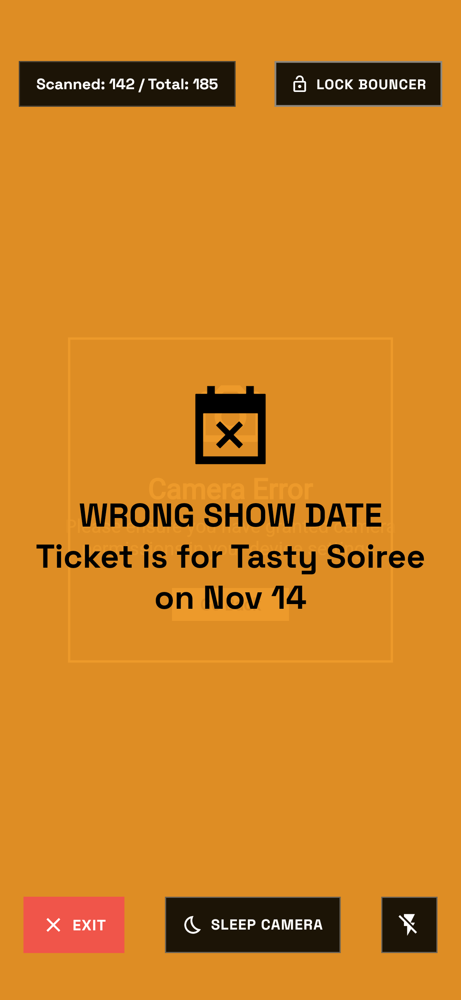

# Door Ticket POS, QR Hardware Terminals & Bouncer Mode

Once doors open at a venue or festival, walk-up fans are buying **Door Tickets** while pre-sale ticket holders are getting their **QR Tickets** scanned. BandMath gives venues, promoters, tour managers, and bands a complete box-office hardware and door-staff ecosystem—without ever exposing private financial ledgers.

---

## 1. Multi-Custodian Door Ticket POS (`[ QUICK SELL DOOR TICKETS ]`)

At a live show, the person who ran online pre-sales isn't always the person sitting at the door with a cash box or phone terminal. Sometimes the **Venue** rings up door tickets, sometimes the **Tour Manager** runs the door, and sometimes a **Band** member sells walk-up tickets next to the merch table.

1. Any authorized participant on the show (**Venue**, **Promoter**, **Tour Manager**, or **Band**) can tap **`[ QUICK SELL DOOR TICKETS ]`** (or use the **Cart** tab in the 3-icon Venue/TM bar).
2. Select the ticket tier and ring up the fan via **[Tap to Pay](../Accept_Payments/01_Tap_to_Pay.md)** or **[Cash](../Accept_Payments/03_Accepting_Cash.md)**.
3. **Zero Cross-Merchant Bleed:** Whoever rings up the Door Ticket collects those funds directly into **their own Merchant Account or Cashbox**.
4. **Automatic Closing Table Netting:** In [The Closing Room](./04_Multi_Band_Closing_Room.md), BandMath breaks down `Door Tickets by Custodian` and automatically deducts whatever cash or card funds each party already collected at the door from their final **Net Closing Envelope** (while keeping the agreed [Event Ticket Tax Set-Aside](../Advanced_Workflows/04_Touring_Tax_and_Nightly_Settlements.md#tier-1-standardized-event-ticket-tax-rate) with the custodian who processed the sale).

---

## 2. QR Hardware Door Terminal Pairing ("The Box of 25 Phones")

Large venues and festivals often keep a fleet of dedicated box-office smartphones or iPads at the entrance. You shouldn't have to create 25 fake email accounts or type your master admin password onto staff devices.

### How Zero-Email QR Terminal Pairing Works
1. **Generate a Pairing QR Code:** In your main **Venue / Promoter User Settings**, open the **Hardware Door Terminals** panel and tap **Pair New Terminal** (e.g., `Terminal 1 — Sarah` or `Box Office East`).
2. **Scan from the Door Device:** On the hardware phone, tap **Pair as Door Terminal** on the login screen and scan the pairing QR code.
3. **Instant Scoped Provisioning:** The device is immediately bound to your Venue/Promoter merchant account in restricted **Door Terminal Mode**—ready to ring up door tickets via Tap to Pay or Cash and scan QR tickets, with zero access to admin settings or payout bank details.

---

## 3. Active Shift Float & End-of-Shift Cash Drop Reconciliation

When multiple box-office staff members work the door across a night, tracking physical cash tills is critical:

* **Starting Cash Float:** When a staff member opens a shift on a paired terminal (e.g., `Terminal 1 — Sarah`), they log their starting change float (e.g., `€100.00`).
* **Live Cash Accumulation:** Every cash door ticket rung up during their shift automatically increments their expected drawer total (e.g., `€100.00 Float + €320.00 Cash Sales = €420.00 Expected`).
* **End-of-Shift Cash Drop Modal:** When closing out their shift, the operator counts the physical cash envelope and submits the **End-of-Shift Cash Drop**. BandMath automatically flags any over/short variance and logs the verified cash drop directly into the night's box office settlement.

---

## 4. Bouncer Mode & The "Hand-Off" Safety Lock

### The Real-World Door Problem
At an independent club or DIY show, a Band Admin, Tour Manager, or Venue Operator often needs to hand their own smartphone to a hired door person or volunteer at the entrance to scan tickets for two hours—**without** letting that person snoop through band bank balances, member standings, or settlement numbers.

### How the Bouncer Lock Solves It
1. Open the **Bouncer** tab (from the Event page or the 3-icon Venue/TM navigation bar).
2. Toggle on the **Bouncer Safety Lock** and hand your phone to your door staff.
3. While locked in **Bouncer Mode**, the screen is strictly restricted to:
   * **Live Camera QR Ticket Scanner:** Instant validation of fan QR tickets with clear visual and haptic feedback for valid check-ins, duplicate scans, or wrong-date tickets.
   * **Wrong-Date / Wrong-Show Guard:** If a fan presents a ticket for tomorrow night's show on a multi-night run, Bouncer Mode triggers an unmistakable **Wrong Show Date** alert showing the ticket's actual event date so door staff never let the wrong ticket through.
   * **Live Guest List & Manual Check-In:** Searchable guest list and ticket holder roster for fans whose phone battery died.
   * **Headcount Progress Bar:** Real-time `Checked In / Total Sold` counter.
4. **Authentication Required to Exit:** If the door person taps to exit Bouncer Mode or tries to switch back to `Standings`, `Home`, or `Settings`, BandMath requires **biometric / device authentication (Face ID, Touch ID, or Passcode)** before unlocking the rest of the app.

### Locking the Home Swipe Too: Android App Pinning & iOS Guided Access

BandMath's **Bouncer Safety Lock** keeps door staff from switching tabs or viewing your band's finances *inside* BandMath. If you also want to block the phone's **Home swipe / App Switcher** so they cannot leave the BandMath app at all, pair it with your phone's built-in kiosk lock:

#### On Android (App Pinning)
1. **One-time setup:** Open Android **Settings** → **Security & privacy** (or **Security**) → **More security & privacy** (or **Advanced**) → **App pinning** *(called **Pin windows** on Samsung One UI)* and toggle it **On**. Turn on **Ask for PIN before unpinning** (or biometric unlock) so only you can unpin.
2. **Pin BandMath:** Open BandMath, turn on **Bouncer Safety Lock**, and then open **Overview** *(Android's name for the **Recents / App Switcher** screen where your open app cards are stacked)*:
   * **Gesture navigation (no bottom buttons):** Swipe up slowly from the very bottom edge of the screen and **hold** for half a second until your open app cards appear.
   * **3-button navigation:** Tap the **square (`■`) Recents button** at the bottom of the screen.
3. Tap the **BandMath app icon** at the top center of the BandMath card *(tap the icon itself, not the preview card)*, then tap **Pin** (or **Pin this app**).
4. **To unpin:**
   * **Gesture navigation:** Swipe up from the bottom edge and **hold** for a second, then enter your PIN / fingerprint / face unlock.
   * **3-button navigation:** Press and **hold** both **Back (`◀`)** and **Recents (`■`)** at the same time, then enter your PIN / biometric unlock.

#### On iPhone & iPad (Guided Access)
1. **One-time setup:** Open iOS **Settings** → **Accessibility** → **Guided Access** and toggle it **On**. Tap **Passcode Settings** to set a Guided Access passcode (and optionally turn on **Face ID** or **Touch ID**).
2. **Lock into BandMath:** Open BandMath and turn on **Bouncer Safety Lock**, then **triple-click the Side button** *(or Home button on older devices)* and tap **Start** in the top-right corner.
3. **To exit:** **Triple-click the Side button** *(or double-click if Face ID / Touch ID is enabled)*, enter your passcode or authenticate, and tap **End** in the top-left corner.

:::note Mobile Camera Requirement for Live QR Scanning
Live camera QR ticket scanning in **Bouncer Mode** is a native mobile app feature available on **iOS and Android**. On desktop web browsers, you can view and search the live Guest List and check in attendees manually.
:::
