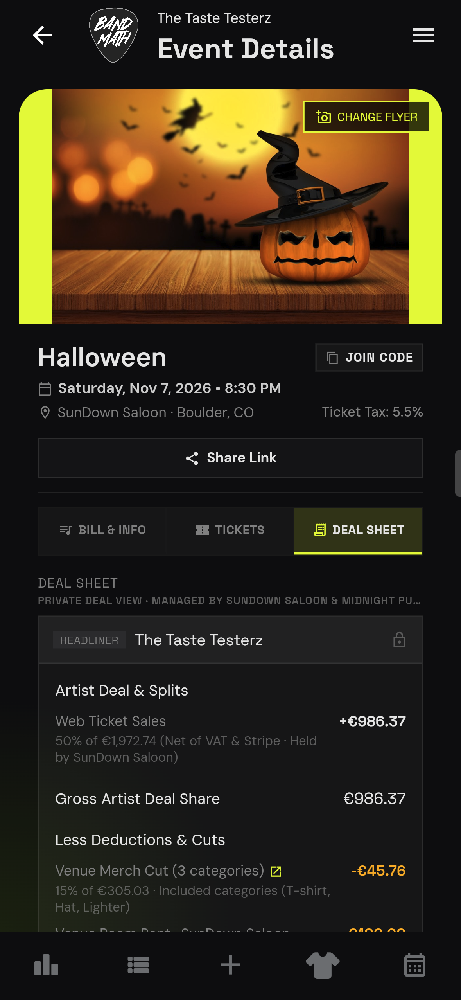

# The Multi-Band Closing Room & Nightly Settlement

At the end of the night, the back-office settlement shouldn't require a messy spreadsheet, three calculators, and scribbled paper napkins. BandMath's **Closing Room ("The Closing Table")** brings the Venue, Promoter, Tour Manager, and every Band on the bill into a live, mathematically verified Deal Sheet and settlement engine that connects directly to each band's internal Ledger.

---

## 1. Shared Show Pot vs. Band-Specific Deal Sheet Items

In a multi-band settlement, some costs and revenues belong to the **entire show**, while others belong to a **single band** or the **house**:

### A. The Shared Show Pot (Dynamic Rebalancing)
The **Closing Officer** (the Tour Manager, Promoter, Venue, or originating/merchant Band) can log shared event incomes and expenses—such as a sound engineer fee, door security, shared backline rental, or a hospitality buyout—and split them across the bill by:
* **Equal Split (`1/N`):** Automatically divides the item equally across all bands on the bill (utilizing the [Penny Catcher](../Features/06_The_Penny_Catcher.md) so no cent is ever lost).
* **Custom Percentage (`%`):** Splits according to agreed deal percentages (e.g., `60% Headliner / 25% Support / 15% Opener`).
* **Fixed Amount (`€ / $`):** Assigns exact dollar/euro amounts per party.

:::tip Dynamic Mid-Show Rebalancing
If another band joins the bill via `[ JOIN SHOW ]` after shared items have already been entered, BandMath dynamically rebalances all unsettled `1/N` shared items to `1/(N+1)`—while strictly preserving any band rows that have already been marked settled (`is_settled = true`)!
:::

### B. Venue Merch Cuts & Two-Tier Tax Transparency
The standalone Venue Split Calculator is built right into each band's **Deal Sheet** inside the Closing Room:
* BandMath automatically pulls every band's POS merchandise sales rung up during the **Event Merch Window** (`3:00 PM – 4:00 AM`).
* Each band's declared **Merch Tax Rate** (and Stripe card processing fees) is backed out first so venue merch cuts (`15%–25%`) are calculated strictly on **Net Merch Revenue**—with the exact math printed right on the Deal Sheet (e.g., `15% of €228.77 (Net of 19% VAT & Stripe)`). For full details on EU & US tax math, see [Live Music Touring Tax & Nightly Settlements](../Advanced_Workflows/04_Touring_Tax_and_Nightly_Settlements.md).

---

## 2. Role-Scoped Privacy Views

Not everyone in the room needs to see another band's private buyout or internal finances:
* **Master / House View (Closing Officer, Tour Manager, Promoter & Venue):** Displays the complete box office summary, `Door Tickets by Custodian`, the Shared Show Pot, and the Net Closing Envelopes for every party on the show.
* **Band Privacy View:** Every participating band sees the transparent **Shared Show Pot** (ticket pool and shared show expenses) plus **only their own band's specific line items, merch totals, and payout envelope**—keeping other bands' private guarantees or side expenses confidential.

---

## 3. Net Closing Envelopes & Multi-Custodian Netting

Because tickets may have been sold online by one merchant and at the door by multiple custodians, BandMath calculates a final **Net Closing Envelope** for each band and the house:
* **Credits:** Your share of the Net Ticket Pool + any band guarantees/buyouts.
* **Less Deductions:** Your share of Shared Show Expenses + any Venue Merch Cut owed to the house + any **Door Ticket Cash/Card you already collected in your own POS** (net of the Ticket Tax set-aside you keep to pay the tax authority).

---

## 4. Granular Settlement-to-Ledger Commits (Including Split-Tender)

When a band is handed their payout envelope (or pays out their share of a venue expense), BandMath **never** silently dumps the money into a generic bucket.

When you tap **Settle** on your band's closing item, BandMath prompts you for explicit custody selection (supporting both single-method and **Split-Tender Cash + Bank Transfer** payouts):
1. **Payment Method:** Was it settled via **`Cash`**, **`Bank Transfer`**, or a **Split-Tender** combination of both?
2. **Received By / Paid Out By:** Who physically took custody of the cash or received the wire transfer?
   * **`Cashbox`** (your band's physical cash till)
   * **`Band Bank`** (your band's shared business checking account)
   * **A Specific Active Band Member (e.g., `John`)**

### Why This Is Magic for Touring Bands
Suppose the promoter hands your guitarist **John** a `€400` cash envelope at the end of the night, and John puts it in his jacket pocket so the band can hit the highway. When you select **`Cash` → Received By: `John`**, BandMath commits the settlement straight into your band's **Transaction Feed (`Home`)** and **Standings**:
* Every band member is credited their equal share of the `€400` show payout.
* John's personal balance is debited `€400` because he is holding the physical cash.
* Your band's [Automated Debt Settlement](../Features/01_The_Ledger.md#automated-debt-settlement) updates instantaneously—zero double-entry data entry required!

---

## 5. One-Tap Automated Final Closing Statement Emails

Once the numbers are settled, tap **`[ EMAIL FINAL CLOSING RECEIPTS ]`**:
* BandMath dispatches itemized, accountant-ready HTML closing statements to the **Venue**, the **Tour Manager / Promoter**, and **every Band on the bill**.
* Each email is strictly **privacy-scoped**: the Venue and Closing Officer receive the full Master/House statement, while each Band receives the Shared Show Pot breakdown alongside their own band's itemized settlement and payout confirmation.
