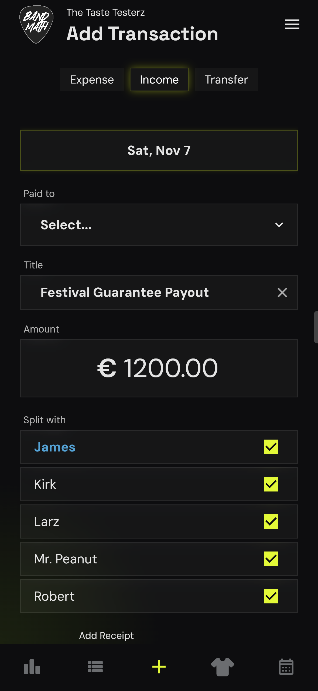
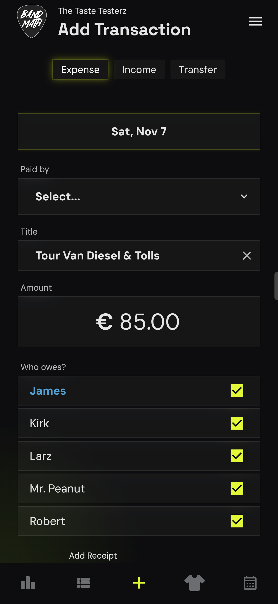
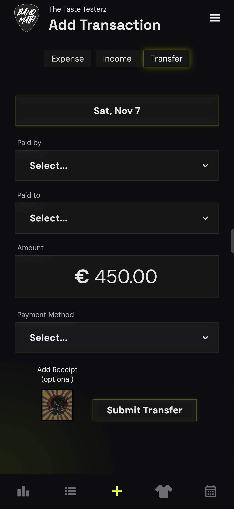
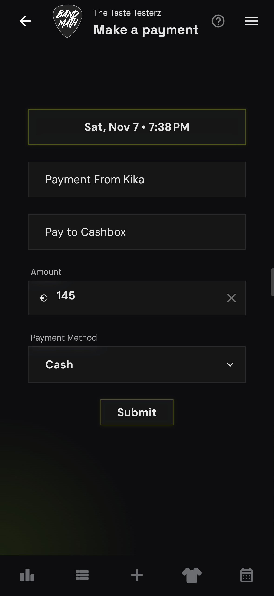

# The Ledger

The Ledger is the core of BandMath. It is a double-entry accounting system tailored specifically for the complexities of touring bands.

## Transactions

Adding, modifying, and deleting transactions is simple. BandMath supports recording:

### Income
Anything from nightly venue payouts, to tips, to merch sales.

### Expenses
Gas for the van, hotels, gear repairs, or just a round of beers at the bar.

### Transfers
Moving money between the Band Bank, VAT Bank, or individual members.

### Modifying & Deleting
You have full editing capabilities to ensure the ledger is always perfectly accurate.

## Shared Expenses & Credits

Touring is a team effort. Anyone in the band can pay for an expense and automatically debit any combination of the other members. 

Similarly, anyone can take a payout (like the cash from the venue) and automatically credit the other members for their cut.

## Automated Debt Settlement

This is the magic of BandMath. Instead of creating a complex web of "who owes who" (e.g., the drummer owes the singer for gas, but the singer owes the guitarist for dinner), the algorithm analyzes the net balances of everyone in the band.

It outputs the absolute simplest way to settle all debts with the fewest number of cash transfers.

## Advanced Profit Splitting (The Penny Catcher)

When an expense or income is split among multiple members, the division rarely works out to clean integers ($10.00 split 3 ways is $3.33333...). 

Our proprietary Penny Catcher algorithm ensures that fractions of a cent are never lost or infinitely rounded, guaranteeing that the ledger balances perfectly to the penny.

## Event Settlement & VAT Integration

Need to settle a multi-band show, calculate a venue merch cut, or split door tickets and shared show expenses? BandMath's [Closing Room](../Events_and_Closing_Room/04_Multi_Band_Closing_Room.md) handles the entire nightly settlement and commits your band's exact payout or expense share directly into the Ledger—letting you specify whether it was paid via **Cash** or **Bank Transfer** and whether it landed in the **Cash Box**, **Band Bank**, or a specific band member's pocket.

When you sell merch or log taxable income, the tax portion of the sale is automatically transferred to the **[VAT Bank](../Team_Management/06_The_VAT_Bank.md)**. This ensures you don't accidentally spend money that you owe to the government.

