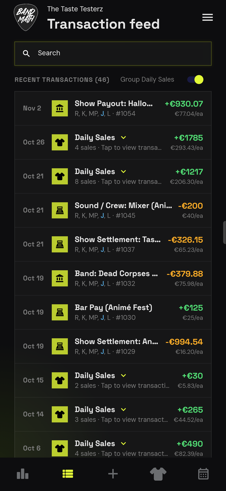
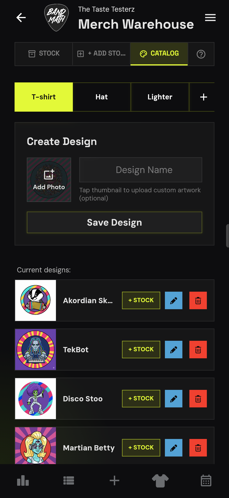
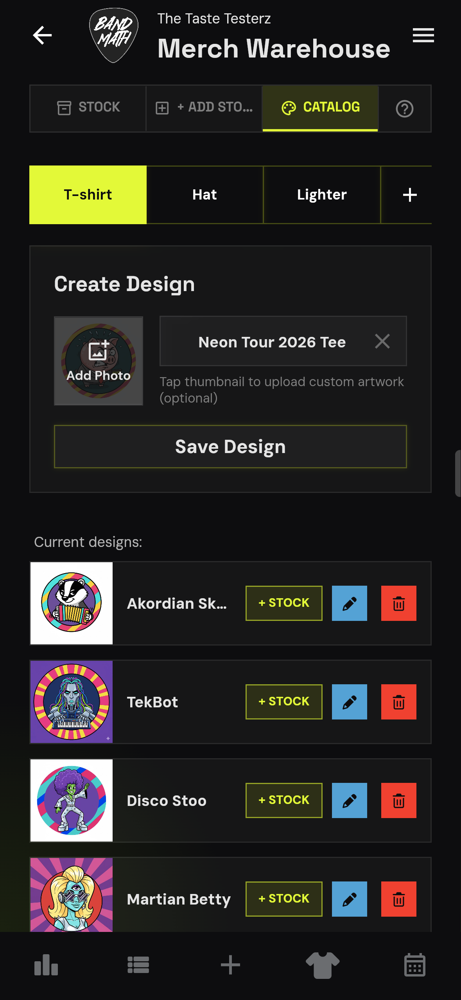
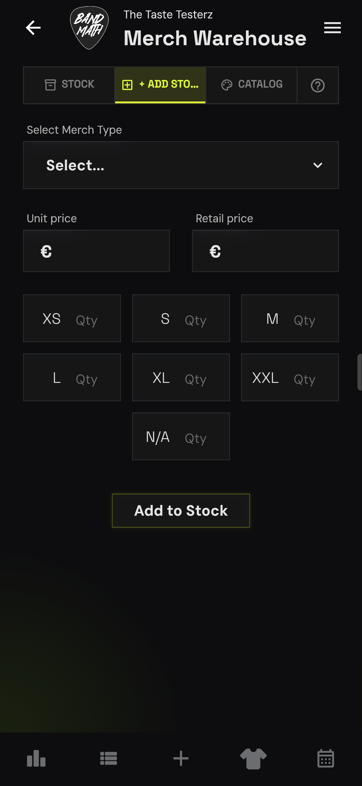
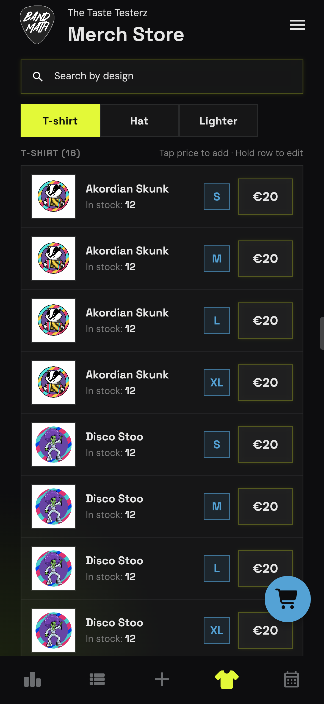
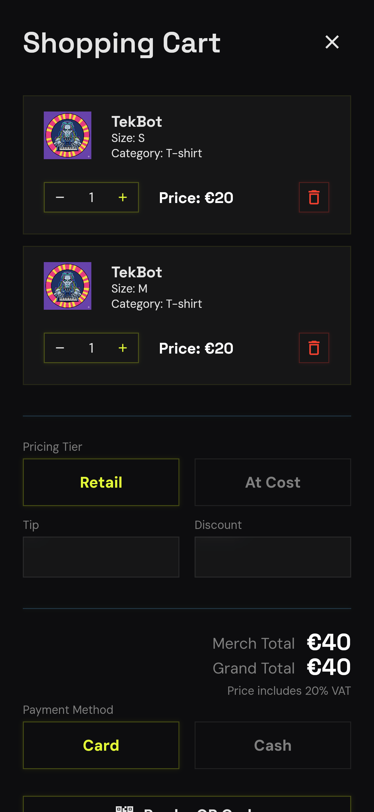
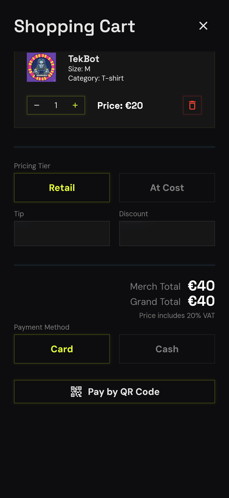
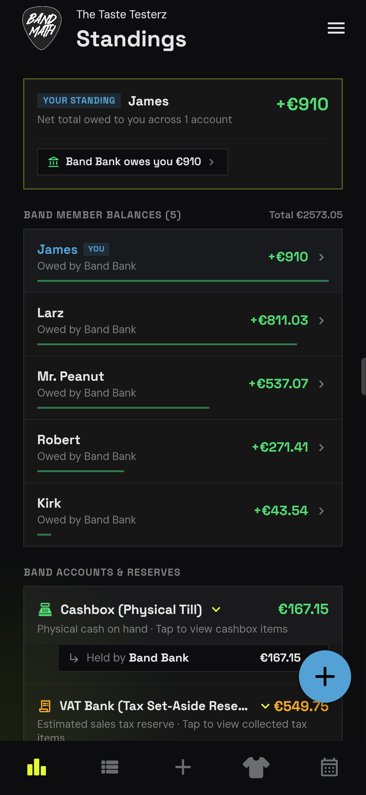

# The First Tour: A Quick Walkthrough

Ready to hit the road? Here is a quick 5-minute walkthrough of the core BandMath loop to get you started on your first tour.

:::tip Playing as a Venue or Tour Manager?
If you run a venue, promote shows, or manage tours for multiple artists, BandMath has a dedicated 3-tab workspace built specifically for box office ticketing, QR hardware door terminals, Bouncer QR scanning, and nightly multi-band settlements. Jump straight to the [Venues & Tour Managers Quickstart](./03_Venues_and_Tour_Managers.md).
:::

## 1. Navigate the 5-Tab Band Workspace

When you log in as a **Band**, your bottom navigation bar gives you instant access to every part of your touring operation:
* **Home:** Your live **Transaction Feed**, plus quick actions to log expenses, incomes, and transfers.
* **Shop (Merch Stand):** Your in-person Point-of-Sale (POS) and access to the **Merch Warehouse** inventory manager.
* **Events:** Your **Events List**, interactive **Band Calendar**, **Setlist Organizer**, online ticketing links, and nightly **Closing Room** settlements.
* **Standings:** Your real-time member balances, **Band Bank**, **VAT Bank**, and one-tap **Automated Debt Settlement**.
* **Cart:** Your live checkout cart for ringing up fans via **Tap to Pay**, **Stripe QR Codes**, or **Cash**.

## 2. Log an Expense

Did someone buy gas for the van?
1. Open the **Home** tab and tap to add a new transaction.
2. Select **Expense**.
3. Select *who paid* for the gas, enter the description (e.g., `Gas`) and amount, and select the band members who should split the cost under *who owes*.
4. Upload a photo of the receipt. 
5. BandMath automatically splits the expense (catching any uneven pennies via the [Penny Catcher](../Features/06_The_Penny_Catcher.md)) and updates everyone's internal balances.
6. Check out the results in the Transaction Feed on **Home** and on the **Standings** tab.

## 3. Stock Your Merch Warehouse

Before you can sell merchandise at a show, set up your catalog and stock levels inside the **Merch Warehouse**:

1. **Create Merch Types:** Define what you print on—from T-Shirts and hoodies to vinyl, hats, lighters, or custom tour posters. Merch types are completely customizable and unlimited.

2. **Add Designs:** Attach designs to your merch types. Give the design a name and upload artwork—or submit right away to use a default Groovatar placeholder.

3. **Add Inventory:** Choose your Product Type and Design, input the unit production cost and retail price, and enter the quantity on hand for each size (items without sizes like vinyl, hats, or stickers use `N/A`).

## 4. Ring Up a Sale in the Merch Stand

When you are at the merch table after a set:
1. Open the **Shop (Merch Stand)** tab.
2. Tap the items and sizes the fan wants to buy to add them to your active **Cart**.

3. Open the **Cart** tab, select the payment method (**Cash**, **Tap to Pay**, or **Stripe QR Code**), and hit **Checkout**.

BandMath atomically deducts the items from your inventory, sets aside any configured sales tax into your **VAT Bank**, and records the net profit across your band roster.

## 5. Settle the Show & Check Standings

At the end of the night:
* Head to the **Events** tab to settle door tickets, shared show expenses, and venue merch cuts in [The Closing Room](../Events_and_Closing_Room/04_Multi_Band_Closing_Room.md).
* Open the **Standings** tab to see [Automated Debt Settlement](../Features/01_The_Ledger.md#automated-debt-settlement) in action—computing the exact minimum number of transfers required for every member to be 100% square.

