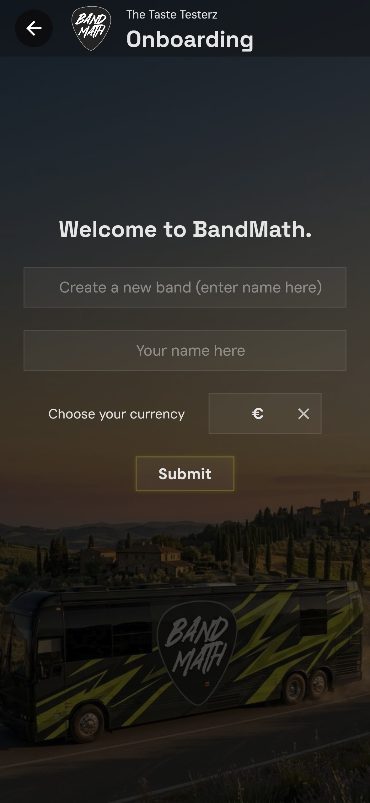
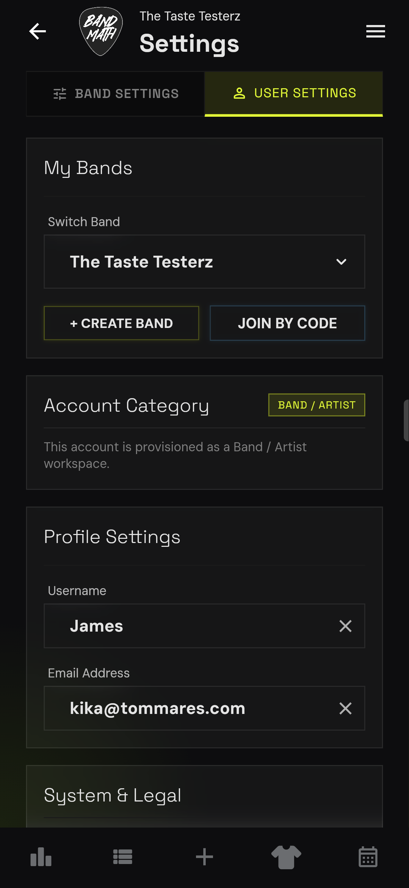

# Choosing Your Persona & Creating a Band

Welcome to BandMath! Whether you play in a touring DIY band, run an independent music venue, or manage multi-band tours, BandMath tailors your workspace to your exact role at the show.

## 1. Fast, Passwordless Login (6-Digit Email OTP)

When you open the BandMath app or visit the web portal at **[account.itsbandmath.com](https://account.itsbandmath.com)**, you can sign up or log in using:
* **6-Digit Email One-Time Code (OTP):** Enter your email address and type in the 6-digit verification code sent straight to your inbox—no passwords to remember at a dark load-in door.
* **Google or Apple Sign-In:** One-tap OAuth login linked to your email address.

## 2. Choosing Your Account Persona (`Band`, `Venue`, or `Tour Manager`)

During onboarding, BandMath asks how you operate in the live music ecosystem:
* **Band (Default):** Unlocks the full 5-tab band workspace (**Home**, **Shop**, **Events**, **Standings**, **Cart**), multi-member ledger accounting, the **Merch Warehouse**, **Setlist Organizer**, and **Band Calendar**.
* **Venue:** Unlocks a streamlined 3-tab box office and settlement workspace (**Events**, **Bouncer**, **Cart**) built for creating shows, scanning tickets, ringing up door sales, and running nightly multi-band settlements.
* **Tour Manager:** Unlocks the 3-tab settlement & box office workspace (**Events**, **Bouncer**, **Cart**) designed for advancing shows, managing the Shared Show Pot across multi-band bills, and issuing final closing receipts.

:::tip Switch Personas Anytime
Wear multiple hats in your local music scene? You are never locked into a single persona. Open **User Settings** (top-right gear/profile menu) at any time to switch your active persona between **Band**, **Venue**, and **Tour Manager**. See our [Venues & Tour Managers Guide](./03_Venues_and_Tour_Managers.md) for full details on external merchant accounts.
:::

## 3. Setting Up Your Band Profile

When operating in the **Band** persona, you will be prompted to create your first **Band Profile** (or join an existing band via invite code). This profile acts as the central hub for your band's financial ledger, merchandise inventory, events, and team members.

### Setting Your Base Currency

During setup, select your band's base currency (e.g., `EUR`, `USD`, `GBP`, `PLN`).

:::note
BandMath handles all math natively using exact integer cents, which means the currency setting is a **display symbol**. You can change your workspace's currency symbol at any time in settings. For tours across currency borders, check out our [Multi-Currency Touring](../Advanced_Workflows/02_Multi_Currency_Touring.md) guide.
:::

## 4. The Default System Accounts

Upon creating your band, BandMath automatically provisions special system accounts in your roster to power double-entry accounting:
1. **[The Band Bank](../Team_Management/04_The_Band_Bank.md):** Represents the communal pool of money held in your band's shared business bank account.
2. **[The Cash Box](../Team_Management/05_The_Cash_Box.md):** Tracks physical cash sitting in your merch till or show settlement envelope before it is deposited or divided.
3. **[The VAT Bank](../Team_Management/06_The_VAT_Bank.md):** Automatically sets aside value-added tax (VAT) or sales tax collected during merch sales so you never accidentally spend government tax money.

These system accounts cannot be deleted, and they stay out of your way when their balances are zero.

## 5. Managing Multiple Bands in User Settings

BandMath supports multiple bands under a single login! You can be a member of an unlimited number of bands, and you can create or serve as an Admin for up to 5 bands simultaneously.

To switch between your bands, open **User Settings** and use the **Band Switcher** dropdown to select the active band workspace.

## Next Steps

Once your band profile is created, you are automatically assigned as the **Admin**. Your next step is to build out your roster by [inviting your band members](./02_Inviting_the_Band.md).
