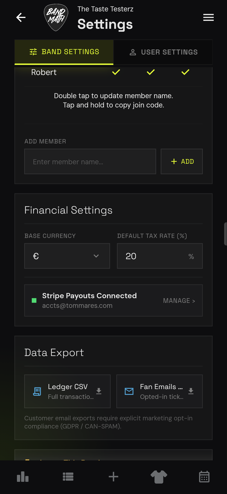

# Localization and Currency

Because BandMath is used by touring bands around the world, you can easily customize the app to fit your region.

## Setting Your Base Currency

When you first [create your band workspace](../Getting_Started/01_Creating_a_Band.md), you will be prompted to select your **Home Currency** from BandMath's 12 supported decimal currencies (`EUR €`, `USD $`, `GBP £`, `CAD CA$`, `AUD A$`, `NZD NZ$`, `CHF`, `PLN zł`, `CZK Kč`, `SEK`, `NOK`, `DKK`).

:::note Permanent Home Currency Lock (`🔒 HOME CURRENCY LOCKED`)

You can adjust your Home Currency in settings right after creating a fresh workspace while your ledger is empty. However, **once your workspace has recorded any transactions, orders, or events, your Home Currency is permanently locked (`🔒 HOME CURRENCY LOCKED`)** so historical settlements, inventory valuations, and Stripe payouts can never be corrupted by a mid-stream currency flip.

**BandMath does not maintain multi-currency sub-ledgers:** all transactions in a workspace operate `1:1` in your locked Home Currency. When touring internationally, see **[Multi-Currency Touring](../Advanced_Workflows/02_Multi_Currency_Touring.md)** for how to handle foreign card sales, cash tables, and `[ COUNT / RECONCILE TILL ]` in your Home Currency!

:::

The base currency symbol is used to format all:
* Ledger calculations
* Debt settlements and payouts
* Merch inventory valuations
* Profit and loss reporting

## Currency Formatting

BandMath automatically formats your financial inputs and displays based on your selected base currency. This means that if you choose Euro (€) as your base currency, the app will automatically inject the `€` symbol into input fields like the merch inventory pricing, preventing typos and ensuring a clean user experience.

If you notice a currency symbol is missing or incorrect, please reach out to support.

## The Unified User Settings Hub

In addition to Band Settings, tapping the settings icon in the top navigation bar opens your personal **User Settings** hub, where you can:
* **Switch Your Active Persona:** Toggle seamlessly between **Band**, **Venue**, and **Tour Manager** modes at any time.
* **Switch Active Bands (Band Persona):** Jump between any of the bands you belong to via the Band Switcher dropdown.
* **Configure Merchant & Stripe Payouts (Venue & Tour Manager Personas):** Connect your Stripe account, set your base currency symbol, and launch the Web Billing Portal (`account.itsbandmath.com`).
* **Send Support & Feedback:** Open the built-in Support modal to message the BandMath team directly from the app.
