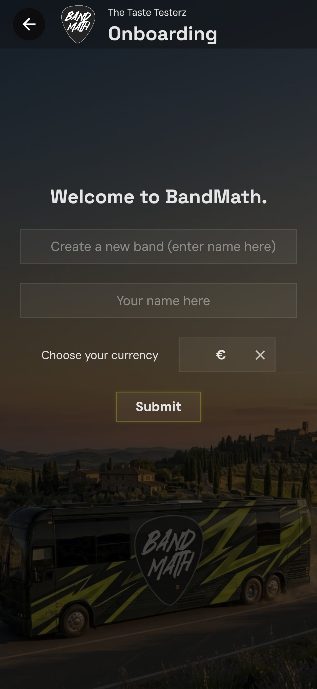
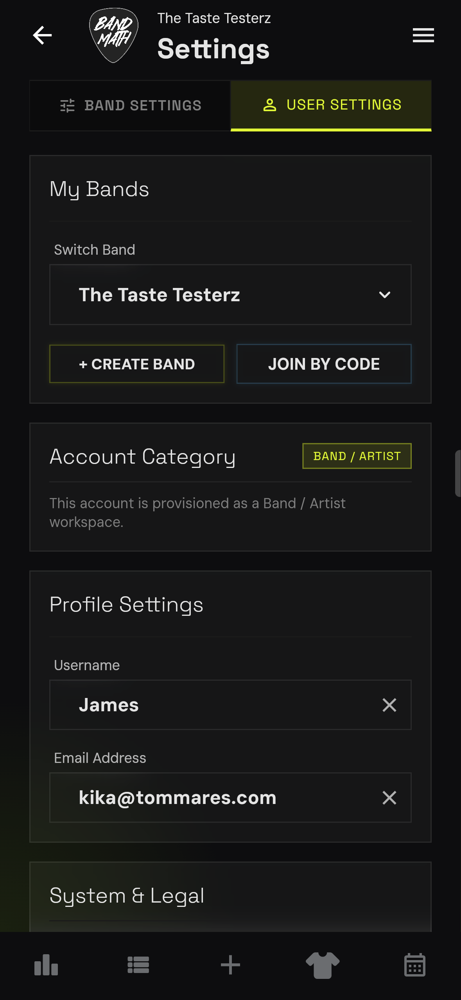

# Choisir votre Profil & Créer un Groupe

Bienvenue sur BandMath ! Que vous jouiez dans un groupe indépendant en tournée, que vous gériez une salle de concert ou que vous soyez Tour Manager, BandMath adapte votre espace de travail à votre rôle exact lors du concert.

## 1. Connexion Rapide sans Mot de Passe (Code OTP à 6 Chiffres)

Lorsque vous ouvrez l'application BandMath ou le portail web sur **[account.itsbandmath.com](https://account.itsbandmath.com)**, vous pouvez vous inscrire ou vous connecter via :
* **Code à Usage Unique par E-mail (OTP à 6 chiffres) :** Entrez votre adresse e-mail et saisissez le code de vérification à 6 chiffres reçu dans votre boîte de réception.
* **Connexion Google ou Apple :** Authentification en un clic liée à votre adresse e-mail.

## 2. Choisir votre Profil (`Groupe`, `Salle`, ou `Tour Manager`)

Lors de votre inscription, BandMath vous demande comment vous opérez :
* **Groupe (Band — Par défaut) :** Débloque l'espace complet à 5 onglets (**Home**, **Shop**, **Events**, **Standings**, **Cart**), la comptabilité multi-membres, le **Merch Warehouse**, le **Setlist Organizer** et le **Band Calendar**.
* **Salle (Venue) :** Débloque une console billetterie et clôture à 3 onglets (**Events**, **Bouncer**, **Cart**) conçue pour créer des concerts, scanner les billets QR, encaisser sur place et gérer la clôture multi-groupes.
* **Tour Manager :** Débloque l'espace de clôture et billetterie à 3 onglets (**Events**, **Bouncer**, **Cart**) pour gérer le pot commun et envoyer les reçus de clôture.

:::tip Changer de Profil à Tout Moment
Vous cumulez plusieurs casquettes sur la scène locale ? Ouvrez **User Settings** (en haut à droite) à tout moment pour basculer entre **Band**, **Venue** et **Tour Manager**. Consultez notre [Guide Salles & Tour Managers](./03_Venues_and_Tour_Managers.md).
:::

## 3. Configurer le Profil de votre Groupe

En mode **Band**, vous êtes invité à créer votre premier **Profil de Groupe** (ou à rejoindre un groupe existant avec un code d'invitation).

### Définir votre Devise de Base

Lors de la configuration, sélectionnez la devise principale de votre groupe (ex. `EUR`, `USD`, `GBP`, `PLN`).

:::note
BandMath effectue tous les calculs en centimes entiers : la devise choisie est uniquement un **symbole d'affichage**. Pour les tournées internationales, consultez notre guide [Tournées Multi-Devises](../Advanced_Workflows/02_Multi_Currency_Touring.md).
:::

## 4. Les Comptes Système par Défaut

À la création de votre groupe, BandMath provisionne automatiquement des comptes système pour la comptabilité en partie double :
1. **[The Band Bank](../Team_Management/04_The_Band_Bank.md) :** Représente le compte bancaire commun du groupe.
2. **[The Cash Box](../Team_Management/05_The_Cash_Box.md) :** Suit les espèces présentes dans votre caisse merch ou enveloppe de concert.
3. **[The VAT Bank](../Team_Management/06_The_VAT_Bank.md) :** Met automatiquement de côté la TVA ou taxe sur les ventes collectée afin de ne jamais dépenser l'argent dû à l'État.

## 5. Gérer Plusieurs Groupes

Vous pouvez être membre d'un nombre illimité de groupes et Administrateur de jusqu'à 5 groupes simultanément. Utilisez le menu déroulant dans **User Settings** pour passer d'un groupe à l'autre.

## Prochaines Étapes

Une fois votre groupe créé, vous en devenez automatiquement l'**Admin**. La prochaine étape consiste à [inviter les membres de votre groupe](./02_Inviting_the_Band.md).
